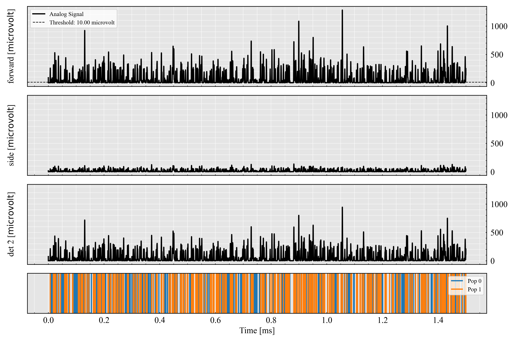

FlowCyPy
========

.. list-table::
   :width: 100%
   :widths: 35 65
   :header-rows: 1

   * - Badge
     - Status
   * - Python versions
     - |mps-python|
   * - Documentation
     - |mps-docs|
   * - Tests
     - |mps-ci| |mps-coverage|
   * - PyPI
     - |mps-pypi| |mps-downloads|
   * - Conda
     - |mps-conda| |mps-conda-downloads| |mps-conda-release|
   * - Zenodo DOI
     - |mps-zenodo|

A package for light scattering computation.

Follow a particle population from the flow cell through illumination, optical
scattering, analog electronics, and digitization. Reusing the same acquired waveform
lets you compare filter settings without changing particle arrivals or detector
noise.

See the `usage guide <https://github.com/MartinPdeS/FlowCyPy/blob/HEAD/USAGE.rst>`__ for further examples and implementation details.
Open the `project notebook in Colab <https://colab.research.google.com/github/MartinPdeS/FlowCyPy/blob/master/notebook.ipynb>`__.

   Analog detector signals during a simulated acquisition.

Installation
------------

Requires Python ``>=3.11``.

.. code-block:: console

   $ python -m pip install FlowCyPy

Install from the ``martinpdes`` Conda channel:

.. code-block:: console

   $ conda install -c martinpdes flowcypy

For an editable source installation:

.. code-block:: console

   $ git clone https://github.com/MartinPdeS/FlowCyPy.git
   $ cd FlowCyPy
   $ python -m pip install -e .

Compare two analog filters
--------------------------

.. code-block:: python

   """
   Compare baseline restoration and low-pass filtering
   ===================================================

   Acquire one forward-scatter waveform on the FACSCanto preset and apply two
   analog filters to it. Using the same waveform keeps particle arrivals and
   detector noise identical across the comparison.
   """

   import matplotlib.pyplot as plt
   from FlowCyPy.fluidics import distributions, populations
   from FlowCyPy.opto_electronics import circuits
   from FlowCyPy.systems.bd import facs_canto
   from FlowCyPy.units import ureg

   instrument = facs_canto(optical_power=100 * ureg.milliwatt, background_power=2 * ureg.microwatt)
   diameter_distribution = distributions.Delta(value=150 * ureg.nanometer)
   refractive_index_distribution = distributions.Delta(value=1.39)
   population = populations.SpherePopulation(
       name="Population",
       concentration=5e9 * ureg.particle / ureg.milliliter,
       diameter=diameter_distribution,
       refractive_index=refractive_index_distribution,
       medium_refractive_index=1.33,
   )
   instrument.fluidics.scatterer_collection.add_population(population)

   # %%
   # Compare the three analog processing chains
   # ------------------------------------------
   record = instrument.acquire(run_time=100 * ureg.microsecond, random_state=42)
   signal = record.signal.analog["forward"].to("volt")
   time = record.signal.analog["Time"].m_as("microsecond")
   sampling_rate = instrument.opto_electronics.digitizer.sampling_rate

   figure, axis = plt.subplots()
   axis.plot(time, signal.m_as("millivolt"), label="Raw signal")
   baseline_restoration = circuits.BaselineRestorationServo(time_constant=10 * ureg.microsecond)
   low_pass_filter = circuits.BesselLowPass(cutoff_frequency=3 * ureg.megahertz, order=4, gain=2)
   for label, circuit in [
       ("Baseline restored", baseline_restoration),
       ("Bessel low-pass", low_pass_filter),
   ]:
       filtered = circuit.process(signal=signal.copy(), sampling_rate=sampling_rate)
       axis.plot(time, filtered.m_as("millivolt"), label=label)
   axis.set(xlabel="Time [µs]", ylabel="Forward-scatter voltage [mV]")
   axis.legend()
   plt.show()

Documentation
-------------

Use the `FlowCyPy documentation <https://martinpdes.github.io/FlowCyPy/>`__ to work through
examples and look up the inputs and return values of individual functions.

Citation
--------

Cite FlowCyPy using DOI `10.5281/zenodo.19097313 <https://doi.org/10.5281/zenodo.19097313>`__.
The Zenodo record provides the citation in BibTeX and other formats.

Contributing
------------

Bug reports, worked examples, and documentation corrections are welcome.
To set up a development checkout and run the tests, follow the `contributing guide <https://github.com/MartinPdeS/FlowCyPy/blob/HEAD/CONTRIBUTING.md>`__.

Contact
-------

For questions, contact `Martin Poinsinet de Sivry-Houle <mailto:martin.poinsinet.de.sivry@gmail.com?subject=FlowCyPy>`__.

License
-------

See the `FlowCyPy license <https://github.com/MartinPdeS/FlowCyPy/blob/HEAD/LICENSE>`__ for terms of use.

.. |mps-python| image:: https://img.shields.io/pypi/pyversions/flowcypy.svg
   :alt: Supported Python versions
   :target: https://pypi.org/project/flowcypy/

.. |mps-pypi| image:: https://img.shields.io/pypi/v/flowcypy.svg
   :alt: PyPI version
   :target: https://pypi.org/project/flowcypy/

.. |mps-downloads| image:: https://img.shields.io/pypi/dm/flowcypy.svg
   :alt: Monthly PyPI downloads
   :target: https://pypistats.org/packages/flowcypy

.. |mps-docs| image:: https://github.com/MartinPdeS/FlowCyPy/actions/workflows/deploy_documentation.yml/badge.svg
   :alt: Documentation
   :target: https://martinpdes.github.io/FlowCyPy/

.. |mps-ci| image:: https://github.com/MartinPdeS/FlowCyPy/actions/workflows/tests.yml/badge.svg
   :alt: Tests
   :target: https://github.com/MartinPdeS/FlowCyPy/actions/workflows/tests.yml

.. |mps-conda| image:: https://anaconda.org/martinpdes/flowcypy/badges/version.svg
   :alt: Anaconda version
   :target: https://anaconda.org/martinpdes/flowcypy

.. |mps-conda-downloads| image:: https://anaconda.org/martinpdes/flowcypy/badges/downloads.svg
   :alt: Anaconda downloads
   :target: https://anaconda.org/martinpdes/flowcypy

.. |mps-conda-release| image:: https://anaconda.org/martinpdes/flowcypy/badges/latest_release_relative_date.svg
   :alt: Latest Anaconda release
   :target: https://anaconda.org/martinpdes/flowcypy

.. |mps-zenodo| image:: https://zenodo.org/badge/DOI/10.5281/zenodo.19097313.svg
   :alt: Cite FlowCyPy on Zenodo
   :target: https://doi.org/10.5281/zenodo.19097313
