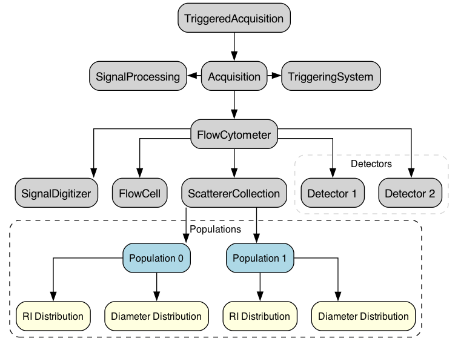
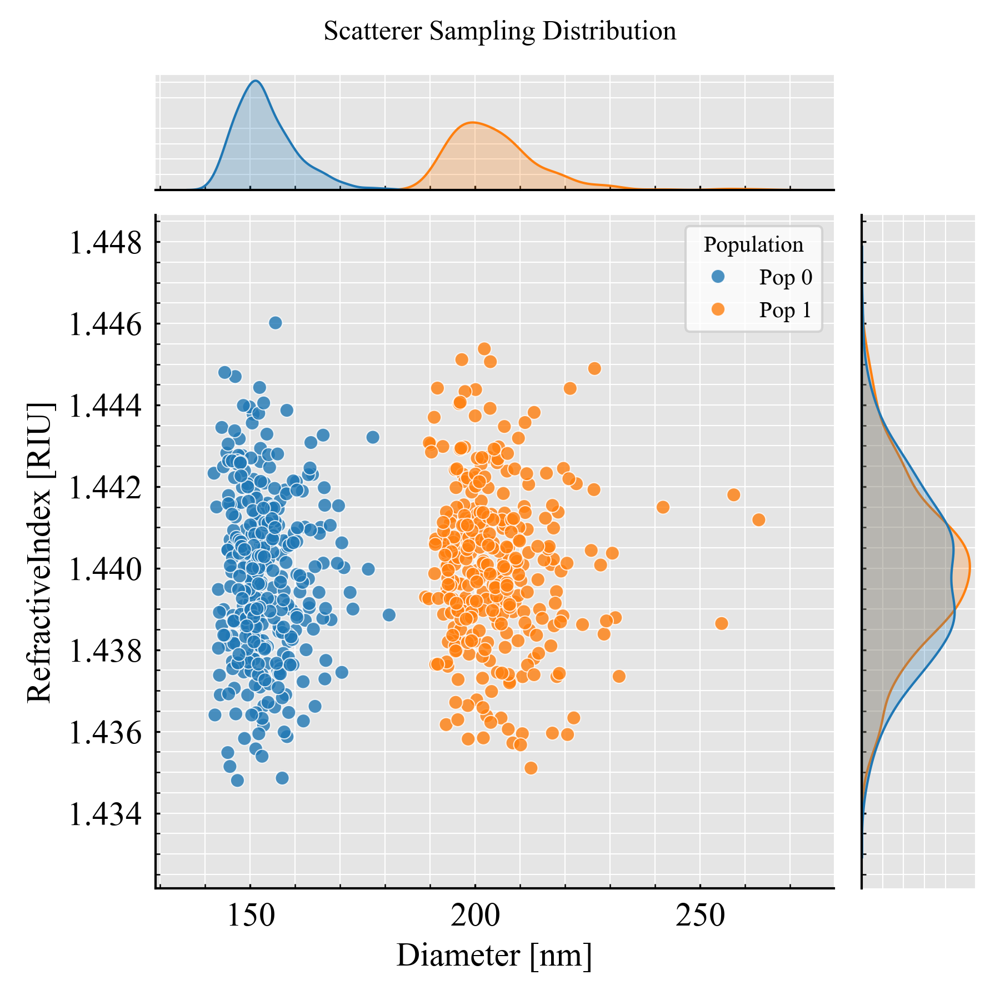
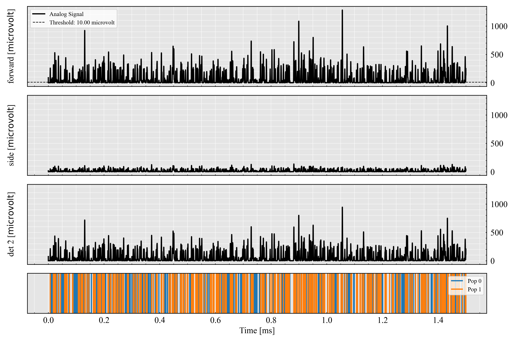
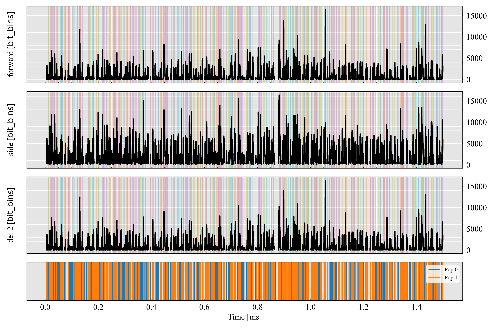

FlowCyPy usage guide
====================

Quick Start
-----------

Simulate a simple flow cytometer experiment:

..  code-block:: python

    from FlowCyPy.units import ureg
    from FlowCyPy.fluidics import (
        Fluidics,
        FlowCell,
        ScattererCollection,
        populations,
        SampleFlowRate,
        SheathFlowRate,
    )

    # from FlowCyPy.sampling_method import GammaModel, ExplicitModel
    from FlowCyPy.fluidics import distributions

    flow_cell = FlowCell(
        sample_volume_flow=SampleFlowRate.MEDIUM.value,
        sheath_volume_flow=SheathFlowRate.MEDIUM.value,
        width=400 * ureg.micrometer,
        height=150 * ureg.micrometer,
    )

    scatterer_collection = ScattererCollection()

    medium_refractive_index = distributions.Delta(1.33)

    diameter_dist = distributions.RosinRammler(
        scale=200 * ureg.nanometer,
        shape=10,
    )

    ri_dist = distributions.Normal(
        mean=1.44,
        standard_deviation=0.002,
        low_cutoff=1.33,
    )

    sampling_method = populations.ExplicitModel()

    population_0 = populations.SpherePopulation(
        name="Pop 0",
        medium_refractive_index=medium_refractive_index,
        concentration=1e10 * ureg.particle / ureg.milliliter,
        diameter=diameter_dist,
        refractive_index=ri_dist,
        sampling_method=sampling_method,
    )

    diameter_dist = distributions.RosinRammler(
        scale=30 * ureg.nanometer,
        shape=50,
    )

    ri_dist = distributions.Normal(
        mean=1.44,
        standard_deviation=0.002,
        low_cutoff=1.33,
    )

    population_1 = populations.SpherePopulation(
        name="Pop 1",
        medium_refractive_index=medium_refractive_index,
        concentration=5e11 * ureg.particle / ureg.milliliter,
        diameter=diameter_dist,
        refractive_index=ri_dist,
        sampling_method=populations.GammaModel(number_of_samples=5_000),
    )

    scatterer_collection.add_population(population_0, population_1)

    scatterer_collection.dilute(factor=80)

    fluidics = Fluidics(scatterer_collection=scatterer_collection, flow_cell=flow_cell)

    # %%
    # Step 2: Define Optical Subsystem
    # --------------------------------
    from FlowCyPy.opto_electronics import (
        Detector,
        Digitizer,
        OptoElectronics,
        Amplifier,
        source,
        circuits,
    )

    analog_processing = [
        circuits.BaselineRestorationServo(time_constant=100 * ureg.microsecond),
        circuits.BesselLowPass(cutoff_frequency=2 * ureg.megahertz, order=4, gain=2),
    ]

    source = source.Gaussian(
        waist_z=10e-6 * ureg.meter,  # Beam waist along flow direction (z-axis)
        waist_y=60e-6 * ureg.meter,
        wavelength=405 * ureg.nanometer,
        optical_power=200 * ureg.milliwatt,
        rin=-140 * ureg.dB_per_Hz,
        bandwidth=10 * ureg.megahertz,
    )

    detectors = [
        Detector(
            name="side",
            phi_angle=90 * ureg.degree,
            numerical_aperture=1.1,
            responsivity=1 * ureg.ampere / ureg.watt,
        ),
        Detector(
            name="forward",
            phi_angle=0 * ureg.degree,
            numerical_aperture=0.3,
            cache_numerical_aperture=0.1,
            responsivity=1 * ureg.ampere / ureg.watt,
        ),
    ]

    digitizer = Digitizer(
        sampling_rate=60 * ureg.megahertz,
        bit_depth=14,
        use_auto_range=True,
        channel_range_mode="shared",
    )

    amplifier = Amplifier(
        gain=10 * ureg.volt / ureg.ampere,
        bandwidth=10 * ureg.megahertz,
        voltage_noise_density=0.0 * ureg.nanovolt / ureg.sqrt_hertz,
        current_noise_density=0.0 * ureg.femtoampere / ureg.sqrt_hertz,
    )

    opto_electronics = OptoElectronics(
        digitizer=digitizer,
        detectors=detectors,
        source=source,
        amplifier=amplifier,
        analog_processing=analog_processing,
    )

    # %%
    # Step 3: Signal Processing Configuration
    # ---------------------------------------
    from FlowCyPy.digital_processing import (
        DigitalProcessing,
        peak_locator,
        discriminator,
    )

    triggering = discriminator.FixedWindow(
        trigger_channel="side",
        threshold="4sigma",
        pre_buffer=40,
        post_buffer=40,
        max_triggers=-1,
    )

    peak_algo = peak_locator.GlobalPeakLocator()

    digital_processing = DigitalProcessing(
        discriminator=triggering,
        peak_locator=peak_algo,
    )

    # %%
    # Step 4: Run Simulation
    # ----------------------
    from FlowCyPy import FlowCytometer

    cytometer = FlowCytometer(
        fluidics=fluidics,
        background_power=0.001 * ureg.milliwatt,
    )

    run_record = cytometer.run(
        opto_electronics=opto_electronics,
        digital_processing=digital_processing,
        run_time=1 * ureg.millisecond,
    )

    run_record.event_collection.plot(x="Diameter")

    run_record.event_collection.plot(x="forward")

    run_record.plot_analog()

    run_record.plot_digital()

    run_record.peaks.plot(x=("forward", "Height"))

|readme_events|

..  code-block:: python

    _ = run_record.plot_analog(
        figure_size=(12, 8),
        show=False,
        save_as=f"{dir_path}/../images/readme_analog.png",
    )

|readme_analog|

..  code-block:: python

    _ = run_record.plot_digital(
        figure_size=(12, 8),
        show=False,
        save_as=f"{dir_path}/../images/readme_digital.png",
    )

|readme_digital|

Explore more examples in the `FlowCyPy Examples <https://martinpdes.github.io/FlowCyPy/gallery/index.html>`_.

Code structure
--------------

Here is the architecture for a standard workflow using FlowCyPy:

|arch|

